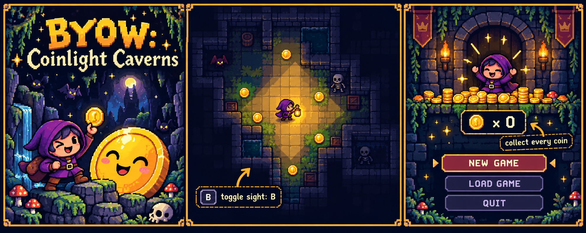

# BYOW — Coinlight Caverns design

`Byow` is a small Java tile game in which the player explores a randomly generated dungeon, toggles a
fog-of-war line of sight, and collects every coin before returning to the main menu. The design,
implementation, and polish were completed by me alone.



## Experience goals

The game should feel like a tiny, mischievous cartridge game: readable tiles, a warm avatar glow,
and a satisfying “one more coin” loop. The generated concept art uses a midnight palette so the
gold coins and visible region remain legible even when the dungeon is busy.

## Core loop

```text
Main menu
  ├─ N: generate a deterministic world from a seed
  │    ├─ optional coin mode
  │    └─ explore with WASD
  ├─ L: rebuild the same world and replay the saved actions
  └─ Q: quit

Coin mode: move onto coins → decrement HUD counter → when zero, show completion state → menu
Visibility: press B → toggle full map / occluded view without changing the underlying world
```

## Feature design

### Line of Sight (primary ambition feature)

- `World` owns the complete map and avatar position.
- `TERenderer.partFrame` asks `Visibility.visibleRegion` for a masked copy.
- The avatar sees a circular radius of eight tiles.
- A wall is visible at the edge of sight, but blocks tiles behind it.
- Hidden cells become `Tileset.NOTHING`; the actual floor, wall, coin, and avatar tiles are never
  deleted or mutated.
- `B` toggles between the normal renderer and the masked renderer.

Keeping visibility as a pure transformation prevents a common fog-of-war bug: collecting a coin or
saving the game must not depend on whether the player currently has sight enabled.

### Coins (secondary ambition feature)

- Coin mode places a deterministic number of coins on floor tiles using the same seeded RNG as the
  world.
- Moving onto a coin immediately converts the cell back to floor and decrements the HUD counter.
- The save/replay stream records movement and sight toggles, so loading reconstructs the same run.
- When the counter reaches zero, the completion screen leads back to the menu, where the player can
  start a new game, load the previous world, or quit.

## Input map

| Key | Action |
| --- | --- |
| `N` | New game |
| `L` | Load saved game |
| `Q` | Quit / save-and-quit sequence |
| `W A S D` | Move |
| `B` | Toggle line of sight |
| `C` | Enable coin mode during setup |

## Code organization

- `proj3/src/core/Main.java` — menus, seed entry, and game-mode selection.
- `proj3/src/core/World.java` — deterministic world generation, movement, save/replay, and coin
  state.
- `proj3/src/tileengine/TERenderer.java` — tile drawing and the full-map/masked-map switch.
- `proj3/src/tileengine/Visibility.java` — bounds-safe line-of-sight calculation.
- `proj3/src/tileengine/Tileset.java` — tile vocabulary, including the gold coin tile.
- `assets/byow-pixel-design.png` — pixel-art design board for the project presentation.

## Verification checklist

1. Use one seed twice and confirm the generated world is identical.
2. Walk into a wall and confirm the avatar does not move or crash at the map boundary.
3. Toggle `B` near a wall: the wall remains visible, while cells behind it are hidden.
4. Collect a coin while sight is on and off; both paths must decrement the same counter.
5. Collect the final coin and confirm the game returns to a menu with New / Load / Quit choices.
6. Save, reload, and confirm the avatar, remaining coins, and visibility state are restored by the
   replay sequence.
